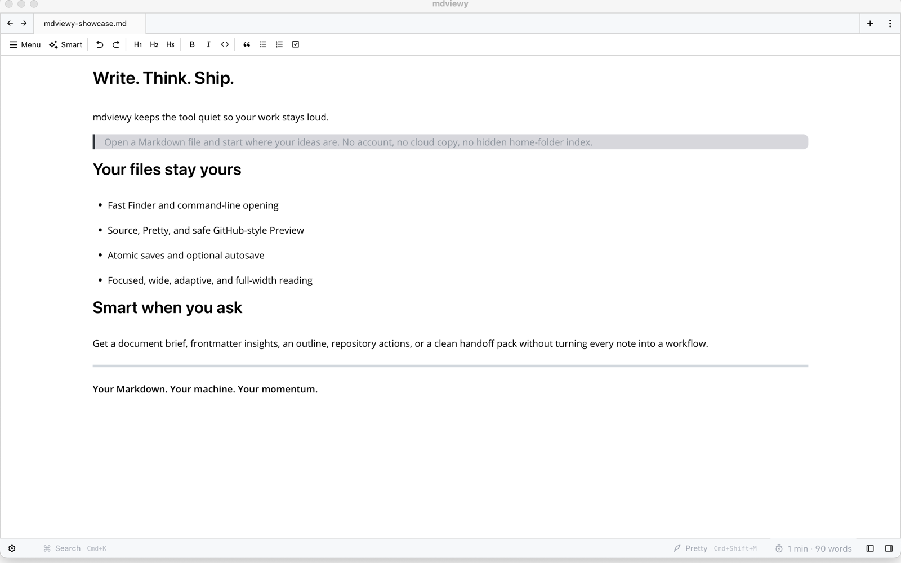

<p align="center">
  
</p>

<h1 align="center">mdviewy</h1>

<p align="center">
  <strong>A local Markdown editor and document viewer for macOS, Windows and Linux.</strong>
</p>

<p align="center">
  <a href="https://github.com/Supersynergy/mdviewy/releases/latest"></a>
  <a href="https://github.com/Supersynergy/mdviewy/actions/workflows/ci.yml"></a>
  <a href="LICENSE"></a>
</p>



[📦 Downloads](#downloads) · [✨ Features](#what-is-included) · [🛠️ Build](#build-from-source) · [🔒 Privacy](#privacy-and-security) · [License](#license)

## Open a document

Open a Markdown file to start writing, or open a folder to search and navigate a workspace. Use Preview to read a README with its tables, task lists and relative images. Switch to Source to edit the original Markdown. Documents stay on disk and opening a folder limits indexing to that workspace.

## What is included

| Area | Capabilities |
| --- | --- |
| Reading | GitHub-style README preview, sanitized HTML, GFM tables, tasks and alerts, relative assets, math, Mermaid diagrams, responsive media |
| Writing | Source and WYSIWYG editing, tabs, spellcheck, typewriter scroll, frontmatter, autosave, atomic file replacement |
| Navigation | File tree, quick open, full-text search, command palette, outline, bookmarks, recent files |
| Smart Actions | Metadata and word insights, deterministic document brief, local-path actions, GitHub repository detection, agent-ready handoff packs |
| Export | HTML, image, Print / Save as PDF |
| Personalization | Light/dark themes, custom themes, shortcuts, focused/wide/full content widths, multilingual UI |
| Safety | No automatic home-folder indexing, bounded workspace scans, recoverable UI errors, CSP, sanitized README HTML |

README files open in the dedicated preview automatically. If a document contains GitHub-only syntax that the visual editor cannot round-trip safely, mdviewy opens Source mode instead of silently changing the file.

## Warm handoffs

Open a file named `_handoff-project.md` to answer questions in the source editor. Put `>>>Userantwort:` on its own line under each question. Empty fields appear in gold. Typing an answer on the same line turns the field green and updates the open count. Press Alt+Shift+N to move to the next open field, then save the Markdown file as usual.

Use `> [!IMPORTANT]` for a decision or `> [!WARNING]` for a risk. The editor also highlights the standard NOTE, TIP and CAUTION markers. Handoff RTF previews highlight answer lines, including exported `Userantwort:` labels.

## Downloads

Download mdviewy for your platform from the [latest stable release](https://github.com/Supersynergy/mdviewy/releases/latest). Each release lists its version and installer filenames. Older versions remain in the [release archive](https://github.com/Supersynergy/mdviewy/releases).

| Platform | Asset to download |
| --- | --- |
| macOS, Apple Silicon | DMG ending in `_aarch64.dmg` |
| macOS, Intel | DMG ending in `_x64.dmg` |
| Windows x64 | `mdviewy_<version>_x64-setup.exe`, or MSI for managed installations |
| Windows without WebView2 | `mdviewy_offline_<version>_x64-setup.exe` |
| Linux x64 | AppImage, Debian package or RPM |

macOS packages use an ad-hoc signature and have not been notarized. Windows installers are unsigned. Your operating system may ask you to confirm the developer when opening the installer.

## Build from source

Requirements: Node.js 26, Corepack/Yarn 4, current stable Rust, and the [Tauri system dependencies](https://v2.tauri.app/start/prerequisites/) for your OS.

```bash
git clone https://github.com/Supersynergy/mdviewy.git
cd mdviewy
corepack enable
yarn install --immutable
yarn setup
yarn dev:desktop
```

Production build:

```bash
yarn build:desktop
```

## Privacy and security

Your documents remain local unless you explicitly configure and call an external AI provider. Provider keys are stored in the local app settings; do not sync that settings file. See [SECURITY.md](.github/SECURITY.md) for supported versions, the security posture, and private reporting.

## Project status

The desktop app focuses on trustworthy file opening, atomic saves, GitHub README fidelity, clean startup, and recovery from renderer failures. The remaining 1.0 gates are tracked in [the roadmap](docs/ROADMAP-1.0.md), including signed/notarized releases, external-edit conflict handling, and end-to-end platform tests.

Issues and focused pull requests are welcome. Start with [CONTRIBUTING.md](.github/CONTRIBUTING.md), use the [issue tracker](https://github.com/Supersynergy/mdviewy/issues), and keep user files and privacy as the first constraint.

## Provenance

mdviewy began as a fork of [MarkFlowy](https://github.com/drl990114/MarkFlowy) and is now independently maintained with a local-first product direction.

## Repository structure

- `apps/`: desktop and web applications; desktop assets include the community theme catalog.
- `packages/` and `crates/`: shared TypeScript packages and Rust crates.
- `docs/`: documentation, architecture decisions, and [attributions](docs/ATTRIBUTIONS.md).
- `.github/`: workflows and community guidelines, including the [Code of Conduct](.github/CODE_OF_CONDUCT.md).
- `tools/config/`: shared build, TypeScript, and vulnerability-scanner configuration.
- `scripts/`, `locales/`, and `public/`: automation, translations, and public assets.

## License

[AGPL-3.0-only](LICENSE)
